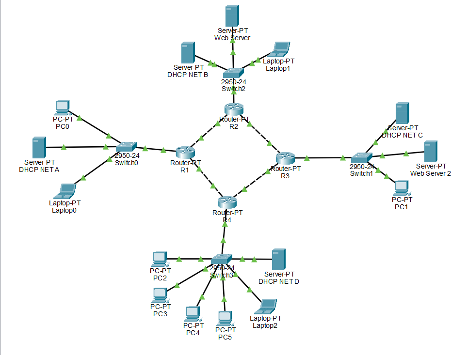
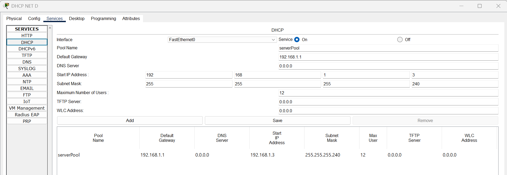
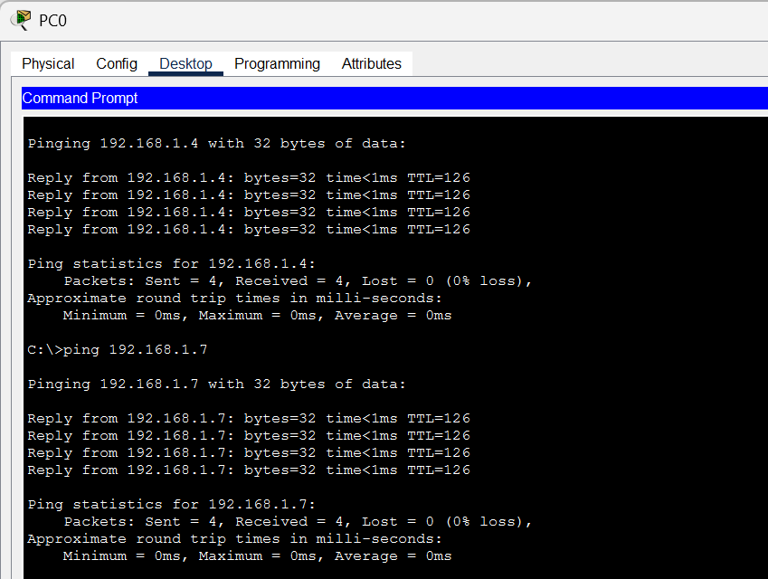
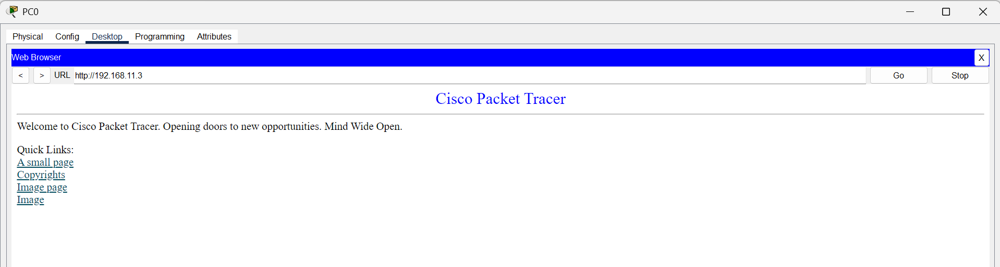

# Multi-Subnet Network Architecture & CIDR Scalability (Cisco Packet Tracer)



## Overview
This project demonstrates the design, configuration, and scalability optimization of a **multi-subnet enterprise network** connecting four distinct Local Area Networks (**SubNet A, SubNet B, SubNet C, and SubNet D**) across four routers (**R1, R2, R3, and R4**) using **Cisco Packet Tracer**.

To prevent IP address wastage, the addressing scheme applies **Classless Inter-Domain Routing (CIDR)**—utilizing `/29` and `/28` prefixes for end-user subnets and `/30` prefixes for point-to-point inter-router links—paired with **Static Routing**, centralized **DHCP**, and **HTTP Web Services**.

---

## Network Architecture & IP Addressing Plan

Each inter-router link is allocated a `/30` subnet (`255.255.255.252`) to provide exactly two usable host addresses for point-to-point gateway communication.

| Network Segment | Network ID | CIDR & Subnet Mask | Key Devices & IP Allocation |
| :--- | :--- | :--- | :--- |
| **SubNet A** | `192.168.8.0` | `/29` (`255.255.255.248`) | Gateway `R1` (`192.168.8.1`), DHCP Server (`192.168.8.2`), 2 End Clients (`PC0` at `192.168.8.3`, etc.) |
| **SubNet B** | `192.168.11.0` | `/29` (`255.255.255.248`) | Gateway `R2` (`192.168.11.1`), DHCP Server (`192.168.11.2`), HTTP Web Server (`192.168.11.3`), 1 Client |
| **SubNet C** | `192.168.2.0` | `/29` (`255.255.255.248`) | Gateway `R3` (`192.168.2.1`), DHCP Server (`192.168.2.2`), HTTP Web Server (`192.168.2.3`), 1 Client |
| **SubNet D (Initial)** | `192.168.1.0` | `/29` (`255.255.255.248`) | Gateway `R4` (`192.168.1.1`), DHCP Server (`192.168.1.2`), 2 Initial Clients |
| **SubNet D (Expanded)** | `192.168.1.0` | `/28` (`255.255.255.240`) | Gateway `R4` (`192.168.1.1`), DHCP Server (`192.168.1.2`), 5 Clients (4 PCs + 1 Laptop) |
| **Link R1 – R2** | `192.168.20.0` | `/30` (`255.255.255.252`) | Point-to-point: `R1` (`192.168.20.1`) ↔ `R2` (`192.168.20.2`) |
| **Link R2 – R3** | `192.168.21.0` | `/30` (`255.255.255.252`) | Point-to-point: `R2` (`192.168.21.1`) ↔ `R3` (`192.168.21.2`) |
| **Link R3 – R4** | `192.168.23.0` | `/30` (`255.255.255.252`) | Point-to-point: `R3` (`192.168.23.1`) ↔ `R4` (`192.168.23.2`) |
| **Link R1 – R4** | `192.168.22.0` | `/30` (`255.255.255.252`) | Point-to-point: `R1` (`192.168.22.1`) ↔ `R4` (`192.168.22.2`) |

---

## Scalability Case Study: SubNet D Expansion (`/29` → `/28`)

During network expansion, **3 additional workstations (`PC3`, `PC4`, and `PC5`)** were added to **SubNet D**, increasing total host requirements beyond the capacity of the initial `/29` subnet.

### Engineering & Reconfiguration Steps
1. **CIDR Prefix Migration:**
   * A `/29` block provides only **6 usable IP addresses**, whereas the expanded segment required **7 usable IPs** (1 Default Gateway, 1 DHCP Server, and 5 Dynamic Clients—9 total addresses including Network ID and Broadcast).
   * Migrated SubNet D to a **`/28` prefix (`255.255.255.240`)**, expanding capacity to **14 usable IP addresses**.
2. **Gateway & DHCP Pool Reconfiguration:**
   * Updated interface `FastEthernet6/0` on **Router R4** (`192.168.1.1`) to use subnet mask `255.255.255.240`.
   * Reconfigured the `serverPool` on **DHCP NET D** (`192.168.1.2`) with starting IP `192.168.1.3`, subnet mask `255.255.255.240`, and maximum user allocation set to 12 hosts.
3. **Static Routing Table Updates:**
   * Removed legacy `192.168.1.0/29` static routes and propagated the updated `192.168.1.0/28` route across neighboring routers:
     * **R1:** `ip route 192.168.1.0 255.255.255.240 192.168.20.2`
     * **R2:** `ip route 192.168.1.0 255.255.255.240 192.168.21.2`
     * **R3:** `ip route 192.168.1.0 255.255.255.240 192.168.23.2`
4. **Client DHCP Lease Renewal:**
   * Refreshed DHCP requests across all end devices in SubNet D, assigning valid `/28` addresses (`192.168.1.3` through `192.168.1.7`).



---

## Connectivity & Service Verification

* **Cross-Subnet ICMP Ping Tests:** Verified bidirectional reachability between **SubNet A** (`PC0` - `192.168.8.3`) and newly added hosts in **SubNet D** (`PC3` - `192.168.1.4` and `PC5` - `192.168.1.7`), achieving **100% delivery (`Sent = 4, Received = 4, 0% packet loss`)**.
* **Application Layer (HTTP) Access:** Confirmed end-to-end web service accessibility from client browsers in SubNet A to the HTTP Web Server hosted in **SubNet B** (`http://192.168.11.3`).




---

## Repository Structure

```text
├── README.md                                                  # Project documentation and network design
├── simulation/
│   └── multi-subnet-cidr-scalability.pkt                      # Cisco Packet Tracer simulation file
└── images/
    ├── topology-overview.png                                  # Full logical network topology
    ├── subnet-d-dhcp-config.png                               # SubNet D /28 DHCP server configuration
    ├── connectivity-ping-test-subnet-a-to-subnet-d.png        # Cross-subnet ICMP ping results
    └── connectivity-http-test-subnet-a-to-subnet-b.png        # Cross-subnet HTTP test results
```

---

## Author
**Valencia Theodora**  
B.Sc. in Informatics Engineering (Network & Cyber Security Specialization) — University of Surabaya  
[LinkedIn](https://www.linkedin.com/in/valencia-theodora) | [GitHub](https://github.com/valenciatheodora07-tech)
